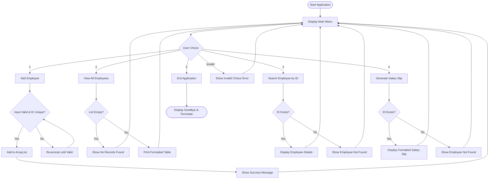

# Task 5: Employee Payroll System – Project Documentation

## 1. Introduction
The **Employee Payroll System** is a modular, console-based enterprise utility developed in **Core Java**. It manages employee payroll records, automates salary calculations based on basic pay, allowances, progressive tax brackets, and mandatory/voluntary deductions, and produces standardized salary slips for organizational transparency.

---

## 2. Objective
The primary objective of this project is to implement a reliable, clean, and interactive console application in Core Java that:
- Applies fundamental and intermediate Object-Oriented Programming (OOP) concepts.
- Maintains in-memory employee records using `ArrayList<Employee>`.
- Accurately computes payroll financials (Gross, Tax, Deductions, Net).
- Validates user input to prevent runtime errors and ensure data integrity.
- Provides a clean, professional user interface suitable for internship assessment and real-world reference.

---

## 3. Task Requirements
- **Language**: Core Java only (no external libraries, GUI frameworks, or databases).
- **Data Structure**: Dynamic list storage via `java.util.ArrayList`.
- **Architecture**: Modular OOP design with encapsulation, proper access modifiers, and clear separation of concerns.
- **Financial Logic**:
  - Gross Salary = Basic Salary + Allowances.
  - Progressive tax computation across 4 predefined slabs (0%, 5%, 10%, 15%).
  - Net Salary = Gross Salary - Tax - Deductions.
- **Reporting**: Formatted console salary slip generation.
- **Defensive Design**: Rejection of negative amounts, duplicate employee IDs, blank names/departments, and invalid menu inputs.

---

## 4. System Features
1. **Add Employee**: Registers new employees with custom financial attributes while strictly enforcing ID uniqueness and non-negative constraints.
2. **View All Employees**: Renders all registered employees in a formatted table displaying ID, Name, Department, Gross Salary, and Net Salary.
3. **Search Employee**: Performs a linear lookup on `ArrayList<Employee>` by employee ID and displays comprehensive salary details.
4. **Generate Salary Slip**: Formats and prints an official salary slip displaying basic salary, allowances, gross earnings, calculated tax, deductions, and take-home net salary.
5. **Interactive Console Menu**: A looping CLI menu allowing continuous operations until user opts to exit.

---

## 5. Class Design

### Class Diagram Overview

```
+-------------------------------------------------------------+
|                           Employee                          |
+-------------------------------------------------------------+
| - employeeId: int                                           |
| - employeeName: String                                      |
| - department: String                                        |
| - basicSalary: double                                       |
| - allowances: double                                        |
| - deductions: double                                        |
+-------------------------------------------------------------+
| + Employee(id: int, name: String, dept: String,             |
|            basic: double, allow: double, ded: double)       |
| + getEmployeeId(): int                                      |
| + setEmployeeId(id: int): void                              |
| + getEmployeeName(): String                                 |
| + setEmployeeName(name: String): void                       |
| + getDepartment(): String                                   |
| + setDepartment(dept: String): void                         |
| + getBasicSalary(): double                                  |
| + setBasicSalary(basic: double): void                       |
| + getAllowances(): double                                   |
| + setAllowances(allow: double): void                        |
| + getDeductions(): double                                   |
| + setDeductions(ded: double): void                          |
| + calculateGrossSalary(): double                            |
| + calculateTax(): double                                    |
| + calculateNetSalary(): double                              |
| + displaySalarySlip(): void                                 |
| + displayDetails(): void                                    |
+-------------------------------------------------------------+

                                ^
                                | (stores in ArrayList<Employee>)
                                |

+-------------------------------------------------------------+
|                    EmployeePayrollSystem                    |
+-------------------------------------------------------------+
| - employeeList: ArrayList<Employee>                         |
+-------------------------------------------------------------+
| + EmployeePayrollSystem()                                   |
| + findEmployeeById(id: int): Employee                       |
| + isEmployeeIdTaken(id: int): boolean                       |
| + addEmployeeRecord(employee: Employee): boolean            |
| + addEmployee(scanner: Scanner): void                       |
| + viewAllEmployees(): void                                  |
| + searchEmployee(scanner: Scanner): void                    |
| + generateSalarySlip(scanner: Scanner): void                |
| + static displayMenu(): void                                |
| + static main(args: String[]): void                         |
| - readNonEmptyString(scanner: Scanner, prompt: String): Str |
| - readPositiveInt(scanner: Scanner, prompt: String): int    |
| - readNonNegativeDouble(scanner: Scanner, prompt: Str): dbl |
+-------------------------------------------------------------+
```

---

## 6. Employee Data Fields

| Field Name | Data Type | Access | Description |
| :--- | :--- | :--- | :--- |
| `employeeId` | `int` | `private` | Unique numerical identifier for the employee. |
| `employeeName` | `String` | `private` | Full name of the employee. |
| `department` | `String` | `private` | Department or division the employee belongs to. |
| `basicSalary` | `double` | `private` | Core base monthly salary ($\ge 0.0$). |
| `allowances` | `double` | `private` | Additional allowances like HRA, DA, travel ($\ge 0.0$). |
| `deductions` | `double` | `private` | Deductions like insurance, PF, loan repayments ($\ge 0.0$). |

---

## 7. Salary Calculation

Gross salary represents the total earnings of an employee prior to any taxes or statutory deductions.

$$\text{Gross Salary} = \text{Basic Salary} + \text{Allowances}$$

*Implementation (`Employee.java`):*
```java
public double calculateGrossSalary() {
    return this.basicSalary + this.allowances;
}
```

---

## 8. Tax Calculation

Tax calculation is determined progressively based on the total Gross Salary according to the following rules:

| Slab | Gross Salary Range | Tax Rate | Formula |
| :--- | :--- | :--- | :--- |
| Slab 1 | $\le 25,000$ | 0% | $0.00$ |
| Slab 2 | $> 25,000$ and $\le 50,000$ | 5% | $\text{Gross Salary} \times 0.05$ |
| Slab 3 | $> 50,000$ and $\le 100,000$ | 10% | $\text{Gross Salary} \times 0.10$ |
| Slab 4 | $> 100,000$ | 15% | $\text{Gross Salary} \times 0.15$ |

*Implementation (`Employee.java`):*
```java
public double calculateTax() {
    double grossSalary = calculateGrossSalary();

    if (grossSalary <= 25000.0) {
        return 0.0;
    } else if (grossSalary <= 50000.0) {
        return grossSalary * 0.05;
    } else if (grossSalary <= 100000.0) {
        return grossSalary * 0.10;
    } else {
        return grossSalary * 0.15;
    }
}
```

---

## 9. Deduction Calculation
Deductions include insurance, provident fund (PF), and company dues entered by the user. The system verifies that deductions cannot be negative:
- Deductions $\ge 0.0$

---

## 10. Net Salary Calculation

Net salary is the final take-home compensation for an employee after taxes and deductions:

$$\text{Net Salary} = \text{Gross Salary} - \text{Tax} - \text{Deductions}$$

*Implementation (`Employee.java`):*
```java
public double calculateNetSalary() {
    double grossSalary = calculateGrossSalary();
    double tax = calculateTax();
    return grossSalary - tax - this.deductions;
}
```

---

## 11. Menu Workflow



---

## 12. Input Validation

The system implements defensive input handling:
1. **Empty Strings**: Names and Department fields cannot consist solely of whitespace or empty strings.
2. **Numeric Validation**:
   - `Integer.parseInt()` wrapped in try-catch to avoid crashes on non-numeric characters for ID and menu choice.
   - `Double.parseDouble()` wrapped in try-catch to reject alphanumeric tokens for salaries, allowances, and deductions.
3. **Value Range Restrictions**:
   - Employee ID must be $> 0$.
   - Basic Salary, Allowances, and Deductions must be $\ge 0$.
4. **Duplicate Prevention**:
   - The system checks existing IDs in `ArrayList<Employee>` prior to registration.
5. **Scanner Flush Management**:
   - Uses line-based reading (`scanner.nextLine()`) to avoid token-buffering bugs common with `nextInt()` and `nextDouble()`.

---

## 13. Testing

An automated test suite (`TestPayrollRunner.java`) was executed covering all required test cases:

| Test # | Test Scenario | Description | Status |
| :--- | :--- | :--- | :--- |
| **Test 1** | Add Single Employee | Added an employee with valid details and verified retrieval. | **PASSED** |
| **Test 2** | Add Multiple Employees | Stored 3 employee records and verified all 3 exist. | **PASSED** |
| **Test 3** | Duplicate ID Rejection | Attempted to insert identical ID `101`; rejected correctly. | **PASSED** |
| **Test 4** | View All Employees | Verified tabular format output and column headers. | **PASSED** |
| **Test 5** | Search Existing Employee | Located existing employee `101` and validated returned fields. | **PASSED** |
| **Test 6** | Search Non-Existing Employee | Queried non-existent ID `999`; returned `null` / not found. | **PASSED** |
| **Test 7** | Generate Salary Slip | Verified salary slip format, headers, alignment, and values. | **PASSED** |
| **Test 8** | Salary Calculation Logic | Verified Basic ($50,000$) + Allowances ($10,000$) = Gross ($60,000$). | **PASSED** |
| **Test 9** | Tax Slab Calculations | Tested all 4 slabs (0%, 5%, 10%, 15%) and boundary limits. | **PASSED** |
| **Test 10** | Invalid Inputs (Negative/Alpha) | Verified rejection and re-prompting for negative and string inputs. | **PASSED** |
| **Test 11** | Invalid Menu Choices | Handled out-of-range numbers and string inputs gracefully. | **PASSED** |
| **Test 12** | Application Exit | Verified application terminates cleanly with farewell message. | **PASSED** |

**Summary**: 12/12 Tests Passed (100% Success Rate).

---

## 14. Sample Output

### 14.1 Main Menu
```
========================================
        EMPLOYEE PAYROLL SYSTEM         
========================================
1. Add Employee
2. View All Employees
3. Search Employee
4. Generate Salary Slip
5. Exit
========================================
Enter your choice: 
```

### 14.2 Adding an Employee
```
----------------------------------------
            ADD NEW EMPLOYEE            
----------------------------------------
Enter Employee ID: 101
Enter Employee Name: John Doe
Enter Department: IT
Enter Basic Salary: 50000
Enter Allowances: 10000
Enter Deductions: 2000

Employee added successfully.
```

### 14.3 Tabular View
```
--------------------------------------------------------------------------------
                              ALL EMPLOYEE RECORDS                              
--------------------------------------------------------------------------------
ID       | Name                   | Department       | Gross Salary  | Net Salary   
--------------------------------------------------------------------------------
101      | John Doe               | IT               | 60000.00      | 52000.00     
102      | Jane Smith             | HR               | 35000.00      | 32250.00     
103      | Robert Brown           | Finance          | 110000.00     | 88500.00     
--------------------------------------------------------------------------------
```

### 14.4 Salary Slip
```
========================================
           EMPLOYEE SALARY SLIP         
========================================
Employee ID    : 101
Employee Name  : John Doe
Department     : IT
----------------------------------------
Basic Salary   : 50000.00
Allowances     : 10000.00
Gross Salary   : 60000.00
Tax            : 6000.00
Deductions     : 2000.00
Net Salary     : 52000.00
========================================
```

---

## 15. Conclusion
The **Employee Payroll System** provides a reliable, robust, and clean console application for employee compensation processing. By adhering strictly to Core Java capabilities and Object-Oriented best practices, the application guarantees code readability, high maintainability, fault-tolerant user interaction, and exact financial calculations. It fulfills all criteria required for Task 5 and internship project evaluation.
